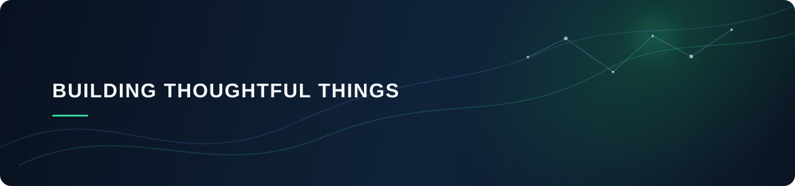

  

 

  

 

## Hello there 👋

I'm **Guangyang Guo**, a developer who enjoys turning curious ideas into useful, well-crafted software.

I work across Python, AI applications, and backend development. My research background occasionally informs what I build, but this space is mostly for sharing practical experiments, tools, and things I find worth making.

<table>
  <tr>
    <td width="50%" valign="top">
      <h3>What I enjoy building</h3>
      <ul>
        <li>Useful AI-powered experiences</li>
        <li>Clear, reliable backend services</li>
        <li>Small tools that solve real problems</li>
      </ul>
    </td>
    <td width="50%" valign="top">
      <h3>Current toolkit</h3>
      

        
      

    </td>
  </tr>
</table>

## Selected work

<table>
  <tr>
    <td width="50%" valign="top">
      <h3>🧭 Featured project</h3>
      
A project I am especially proud of will live here.

      
<a href="https://github.com/guangyangguo?tab=repositories">View repositories →</a>

    </td>
    <td width="50%" valign="top">
      <h3>🧪 Experiments & notes</h3>
      
A home for prototypes, learning notes, and the occasional unfinished but interesting idea.

      
<a href="https://github.com/guangyangguo?tab=repositories">See what I'm exploring →</a>

    </td>
  </tr>
</table>

 

  Quietly learning, deliberately building.

